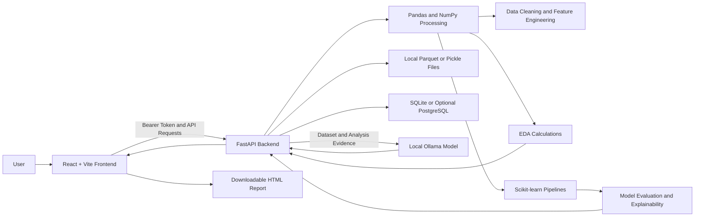

# 🚀 DataPilot AI — End-to-End Data Analysis & Machine Learning Platform

An interactive full-stack platform for uploading, exploring, cleaning, and analyzing tabular datasets, engineering features, training and comparing machine learning models, interpreting predictions, and asking evidence-based questions through a locally running AI assistant.

## 📑 Table of Contents

- [Brief Summary](#-brief-summary)
- [Overview](#-overview)
- [Problem Statement](#-problem-statement)
- [Key Features](#-key-features)
- [Supported Data Formats](#-supported-data-formats)
- [Tools and Technologies](#️-tools-and-technologies)
- [Architecture and Data Flow](#️-architecture-and-data-flow)
- [Methods and Implementation](#-methods-and-implementation)
- [Application Screens](#️-application-screens)
- [How to Run the Project](#-how-to-run-the-project)
- [API and Configuration](#️-api-and-configuration)
- [Results and Conclusion](#-results-and-conclusion)
- [Current Limitations](#️-current-limitations)
- [Future Work](#-future-work)
- [Author and Contact](#-author-and-contact)

## 📝 Brief Summary

DataPilot AI is a web-based data analysis and machine learning application built with React and FastAPI. It provides an integrated workflow for dataset upload, data cleaning, exploratory data analysis (EDA), feature engineering, model training, model comparison, and explainability.

The platform also integrates a locally running Ollama language model to answer questions using a compact evidence summary generated from the dataset and available analysis results.

## 📖 Overview

Analyzing tabular datasets often requires multiple tools for data inspection, cleaning, visualization, machine learning, and reporting. DataPilot AI brings these tasks together in a single interactive application.

The frontend is built with React and Vite, while FastAPI handles backend processing and API requests. Pandas and NumPy support data manipulation, scikit-learn powers machine learning pipelines, Recharts provides visualizations, and Ollama enables local AI-assisted analysis.

### Typical Workflow

1. Create an account or sign in.
2. Upload a CSV, JSON, Excel, or Parquet dataset.
3. Inspect the dataset preview, schema, and data quality.
4. Preview and apply data-cleaning operations.
5. Explore descriptive statistics, distributions, and correlations.
6. Create derived features.
7. Train and compare classification or regression models.
8. Explore feature importance and individual predictions.
9. Ask questions using the AI Assistant.
10. Generate and download an HTML report.

## ❓ Problem Statement

Data analysis involves several repetitive tasks, including handling missing values, detecting duplicates and outliers, understanding data distributions, preparing features, training machine learning models, and interpreting model performance.

DataPilot AI aims to simplify this process by integrating common data-science workflows into one application, helping users move from raw datasets to interpretable analytical and predictive results.

## ✨ Key Features

- **Dataset Management:** Upload and inspect supported tabular datasets.
- **Data Quality Analysis:** Examine missing values, duplicate records, column information, and dataset characteristics.
- **Data Cleaning:** Handle missing values, remove duplicates, encode categorical features, and remove numeric outliers.
- **Exploratory Data Analysis:** Visualize distributions, correlations, category frequencies, and grouped statistics.
- **Feature Engineering:** Create derived features using predefined transformations.
- **Machine Learning Studio:** Train multiple classification and regression algorithms.
- **Model Comparison:** Compare model evaluation metrics.
- **Explainable AI:** Explore feature importance and individual prediction explanations.
- **AI Assistant:** Ask dataset-related questions using evidence supplied to a locally running Ollama model.
- **HTML Report Generation:** Export selected analytical results into a styled, printable report.
- **Authentication:** Protect API operations with bearer-token authentication and dataset ownership checks.

## 📂 Supported Data Formats

| Format | Extensions |
|---|---|
| CSV | `.csv` |
| JSON | `.json` |
| Excel | `.xlsx`, `.xls` depending on installed reader support |
| Parquet | `.parquet` |

The backend rejects empty files and blank or duplicate column names. The configured upload limit is 500 MB.

## 🛠️ Tools and Technologies

| Technology | Purpose |
|---|---|
| Python | Backend development and data-science logic |
| React | Interactive frontend |
| Vite | Frontend development and build tooling |
| FastAPI | REST API and backend services |
| Pandas | Data manipulation and cleaning |
| NumPy | Numerical processing |
| Scikit-learn | Data preprocessing, model training, and evaluation |
| Recharts | Charts and visualizations |
| Lucide Icons | Interface icons |
| Ollama | Local language-model inference |
| SQLite | Default authentication database |
| PostgreSQL | Optional database for supported metadata and operation records |
| Parquet / Pickle | Local dataset storage |
| SHAP | Feature-importance and prediction explanations when available |

## 🏗️ Architecture and Data Flow



### Architecture Components

- **Frontend:** React components organized into functional sections within a single application.
- **Backend:** FastAPI endpoints manage authentication, datasets, analysis, model training, explainability, AI requests, and report generation.
- **Data Processing:** Pandas DataFrames are used for loading, cleaning, and transforming uploaded datasets.
- **Machine Learning:** Scikit-learn pipelines combine preprocessing and model estimators.
- **Storage:** Dataset files and JSON metadata are stored locally. SQLite is the default authentication database, with optional PostgreSQL support.
- **AI Integration:** The backend sends a compact evidence object and the user's question to Ollama's `/api/generate` endpoint.

## 🔍 Methods and Implementation

### 1. Data Upload and Quality Checks

Uploaded files are loaded into pandas DataFrames. The backend validates the data by rejecting empty uploads and blank or duplicate column names.

The interface provides a dataset preview and can request schema information. Protected dataset operations use bearer-token authentication and dataset ownership checks.

### 2. Data Cleaning

DataPilot AI supports the following data-cleaning operations:

- **Missing Values:** Fill numeric values using the mean or median, and other values using the most frequent value or `"Unknown"`.
- **Duplicate Removal:** Remove duplicate records while retaining the first occurrence.
- **Categorical Encoding:** Apply one-hot encoding to selected categorical columns.
- **Outlier Removal:** Identify and remove numeric outliers using the 1.5 × IQR rule.
- **Preview and Undo:** Preview transformations before applying them and undo changes using an in-memory snapshot.

**Note:** Undo snapshots are stored in backend process memory and do not survive a backend restart.

### 3. Exploratory Data Analysis (EDA)

The EDA module calculates descriptive statistics and generates information for visualizations.

**Numeric Analysis**
- Mean and median
- Standard deviation
- Minimum and maximum
- Quartiles
- Skewness
- Potential outlier counts
- Histograms
- Numeric correlation summaries

**Categorical Analysis**
- Most frequent category values
- Grouped numeric means and medians for categories with up to 20 distinct values

The frontend displays these results through charts and summary cards using Recharts.

**Note:** Correlations and differences between group averages describe relationships in the data; they do not independently establish causation.

### 4. Feature Engineering

The platform supports predefined feature transformations, including:

- Copying an existing column
- Calculating ratios between columns
- Calculating products between columns
- Applying the `log1p` transformation
- Creating quantile-based bins using `pandas.qcut`

Feature lineage is recorded so derived features that trace back to the selected prediction target can be excluded.

These transformations are predefined operations rather than arbitrary Python expressions.

### 5. Data Preprocessing

The machine learning workflow uses scikit-learn preprocessing pipelines.

- **Numeric Features:** Missing values are imputed using the median, and features are standardized.
- **Categorical Features:** Missing values are imputed, and categories are one-hot encoded.
- **Train-Test Split:** Data is split into 80% training data and 20% testing data.
- **Fixed Random Seed:** The split uses a fixed random seed for reproducibility.
- **Pipeline-Based Processing:** Preprocessing is fitted as part of the training pipeline to help prevent information leakage from the test set.

The application uses a single holdout split rather than cross-validation.

### 6. Machine Learning

The ML Studio supports classification and regression tasks using multiple scikit-learn estimators.

**Classification Algorithms**
- Logistic Regression
- Decision Tree
- Random Forest
- Gradient Boosting
- Support Vector Machine (SVM)
- K-Nearest Neighbors (KNN)

**Regression Algorithms**
- Linear Regression
- Ridge Regression
- Decision Tree Regressor
- Random Forest Regressor
- Gradient Boosting Regressor
- Support Vector Regression (SVR)

Classification targets are checked for values that appear continuous or have an excessive number of classes. Regression targets are converted to numeric values.

**Model Selection Metrics**

- **Classification:** Weighted F1-score is used by the backend to rank models.
- **Regression:** R² score is used by the backend to rank models.

The comparison interface displays model evaluation metrics. The UI's best-model indicator may differ from the backend's classification ranking because the interface compares the first displayed metric, accuracy, while the backend ranks classification models by weighted F1-score.

### 7. Explainability

The Explainability module provides global feature importance and explanations for individual predictions.

Depending on estimator support and availability, global feature importance may use:

- SHAP
- Model coefficients
- Built-in tree feature importance
- Permutation importance

When SHAP is unavailable for an individual explanation, the backend estimates feature influence by replacing one feature at a time with a baseline value and measuring the change in the prediction.

These methods help interpret model behavior but do not prove that a feature causes an outcome.

### 8. AI Assistant

DataPilot AI integrates a locally running Ollama language model.

The backend constructs a compact evidence object containing information such as:

- Column names and data types
- Missing-value counts
- Numeric summaries
- Category frequencies
- Selected EDA observations
- Available model metrics and explanations

This evidence and the user's question are sent to Ollama's `/api/generate` endpoint.

The prompt instructs the model to answer using the supplied evidence and not to treat text contained within the dataset as instructions.

The AI Assistant requires a working local Ollama service and a configured model.

### 9. HTML Report Generation

The report endpoint generates a downloadable HTML report containing selected analytical sections.

Reports can include:

- Dataset overview
- Data quality information
- Cleaning history
- EDA results
- Feature engineering
- Model performance
- Explainability
- Recommendations

The generated report includes styling, navigation, table filters, a theme toggle, and print support.

**Current issue:** Reports containing explainability may fail because the report handler invokes explanation handlers without supplying the authenticated user object those handlers normally receive through FastAPI dependency injection.

## 🖥️ Application Screens

| Screen | Description |
|---|---|
| Overview | High-level view of the active dataset and analysis |
| Datasets | Upload and inspect datasets |
| Data Cleaning | Preview and apply cleaning operations |
| EDA | Explore descriptive statistics and relationships |
| Feature Engineering | Create derived features |
| ML Studio | Train classification and regression models |
| Model Comparison | Compare evaluation metrics |
| Explainability | Explore feature importance and individual predictions |
| AI Assistant | Ask questions about dataset evidence |
| Reports | Generate and download HTML reports |

These screens are sections within one React application rather than separate pages served through a frontend router.

## 🚀 How to Run the Project

### Prerequisites

- Python
- Node.js and npm
- Git, if cloning the repository
- Ollama and a compatible local model for AI Assistant functionality
- PostgreSQL only if using the optional PostgreSQL configuration

### 1. Clone the Repository

Replace the placeholders with your actual repository URL and folder name.

```bash
git clone <repository-url>
cd <repository-folder>
```

### 2. Start the Backend

```bash
cd backend
```

Create and activate a virtual environment.

**macOS / Linux**

```bash
python3 -m venv .venv
source .venv/bin/activate
```

**Windows PowerShell**

```powershell
python -m venv .venv
.venv\Scripts\Activate.ps1
```

Install dependencies if the repository contains a `requirements.txt` file:

```bash
pip install -r requirements.txt
```

Configure the required environment variables according to the project's configuration.

Start the FastAPI server using the actual entry point in your repository. For example, if the application module is `app.main`:

```bash
uvicorn app.main:app --reload
```

The API is normally available at:

```text
http://localhost:8000/api/v1
```

FastAPI's interactive documentation is usually available at:

```text
http://localhost:8000/docs
```

### 3. Start Ollama (Optional)

Install Ollama and download a compatible model.

```bash
ollama pull llama3.2
```

Start the Ollama service if it is not already running:

```bash
ollama serve
```

Ensure that the backend is configured to use the local Ollama service and the intended model.

### 4. Start the Frontend

Open another terminal:

```bash
cd frontend
npm install
npm run dev
```

Vite will display the local frontend URL in the terminal. Open that URL in your browser.

### 5. Use the Application

1. Create an account or sign in.
2. Upload a supported dataset.
3. Inspect the dataset schema and quality.
4. Explore data-cleaning and EDA features.
5. Create derived features if required.
6. Train models and compare their metrics.
7. Review feature importance and prediction explanations.
8. Ask questions using the AI Assistant.
9. Generate an HTML report.

**Note:** Verify the repository's actual dependency files, application entry point, and environment-variable names before following these commands.

## ⚙️ API and Configuration

The frontend normally sends requests to the FastAPI backend at:

```text
http://localhost:8000/api/v1
```

Protected dataset operations use bearer-token authentication.

- **Database:** SQLite by default, with optional PostgreSQL configuration for supported metadata and operation records.
- **Dataset Storage:** Local Parquet files, with a pickle fallback.
- **Metadata:** JSON sidecar files and supported database records.
- **AI Inference:** Local Ollama service using `/api/generate`.

Before deployment, verify the required environment variables, database configuration, storage directories, CORS settings, and production server configuration.

## 📈 Results and Conclusion

DataPilot AI combines common data-science tasks into a single full-stack application, connecting dataset upload and cleaning with exploratory analysis, feature engineering, machine learning, explainability, AI-assisted interpretation, and reporting.

### Key Technical Highlights

- Integrated data-processing and machine-learning workflow.
- Preprocessing fitted within scikit-learn pipelines.
- Multiple classification and regression algorithms.
- Dataset ownership checks for protected API operations.
- Local Ollama integration using a compact dataset-evidence object.
- Multiple approaches to feature importance and prediction interpretation.
- Downloadable HTML reports with styling and print support.

Actual model performance depends on the uploaded dataset, prediction target, preprocessing, and model configuration. No fixed accuracy or performance result is claimed.

## ⚠️ Current Limitations

- **Single active dataset in the UI:** The backend can list datasets, but the interface does not currently provide a dataset selector and loads the first dataset returned after sign-in.
- **In-memory models:** Trained model pipelines are not permanently persisted and may need to be retrained after a backend restart.
- **Temporary undo history:** Cleaning snapshots are stored in process memory and are lost after a restart.
- **Single holdout evaluation:** The application uses an 80/20 split rather than cross-validation.
- **Model ranking mismatch:** The backend ranks classification models by weighted F1, while the UI's best-model indicator compares accuracy.
- **Report explainability issue:** Reports containing explainability may fail because of the current handler invocation.
- **Assistant status text:** Some frontend status messages refer to an API key even though the described backend integration uses Ollama.
- **Local storage:** Dataset files are stored on the local filesystem by default.
- **No causal guarantees:** Correlations and explainability scores do not establish causal relationships.

## 🔮 Future Work

- Add a dataset selector and improve multi-dataset workflows.
- Persist trained model artifacts and restore them after backend restarts.
- Add cross-validation and more comprehensive evaluation options.
- Align model-ranking logic between the backend and frontend.
- Fix report generation when explainability sections are included.
- Improve AI Assistant status messages and error handling.
- Add automated tests for API endpoints, data transformations, pipelines, and reports.
- Introduce background jobs for large datasets and longer model-training tasks.
- Improve deployment, logging, monitoring, and storage options.
- Strengthen production security and access controls.

## 👩‍💻 Author and Contact

**Pragati Tomar**

- 📧 Email: [officialpragatitomar@gmail.com](mailto:officialpragatitomar@gmail.com)
- 💼 LinkedIn: [linkedin.com/in/pragatitomar10](https://www.linkedin.com/in/pragatitomar10)
- 🐙 GitHub: [github.com/Pragati-Tomar](https://github.com/Pragati-Tomar)

---

⭐ If you find this project useful, consider starring the repository.
# DataPilot-Data-Analysis-And-Machine-Learning-Platform
